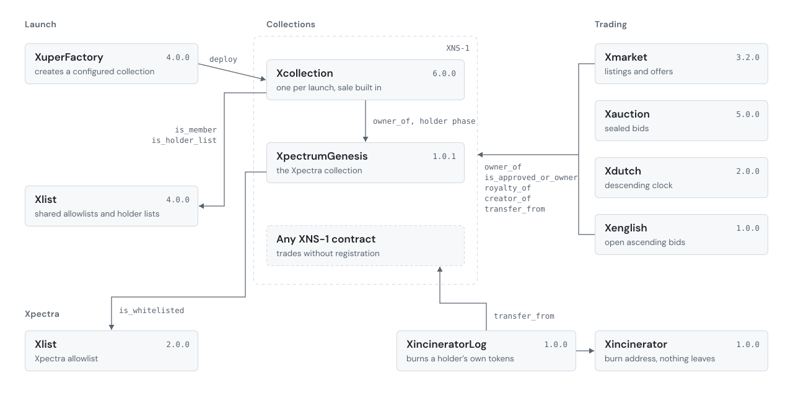

<picture>
  <source media="(prefers-color-scheme: dark)" srcset="./assets/banner-org-dark.svg">
  
</picture>

**[Marketplace](https://app.xpectrum.xyz)** | [Creators](https://creators.xpectrum.xyz) | [Docs](https://docs.xpectrum.xyz) | [xpectrum.xyz](https://xpectrum.xyz) | [X](https://x.com/xpectrum_xyz)

Xpectrum is an NFT marketplace and launch platform on Octra mainnet.
Collections are launched in one transaction, traded through four market contracts, and can keep their art on the chain itself.
Every contract is published as source that compiles to the exact bytecode running at its address.

### On chain

- **Launch.** XuperFactory creates a configured Xcollection in one transaction, with its sale, phases and reveal set at creation.
- **Trade.** Xmarket for listings and offers, Xauction for sealed bids, Xdutch for a descending clock, Xenglish for open bidding.
- **Standard.** XNS-1 is the token interface the market contracts read. Any contract that implements it trades without registration.
- **Xpectra.** The founding collection. Holding one opens the holder phase on collections launched through the factory.

<picture>
  <source media="(prefers-color-scheme: dark)" srcset="./assets/architecture-dark.svg">
  
</picture>

### Repositories

**[xpectrum-contracts](https://github.com/xpectrum-xyz/xpectrum-contracts)**: every deployed contract in AML, with mainnet addresses, verifier certificates and a script that checks each one against the chain.
